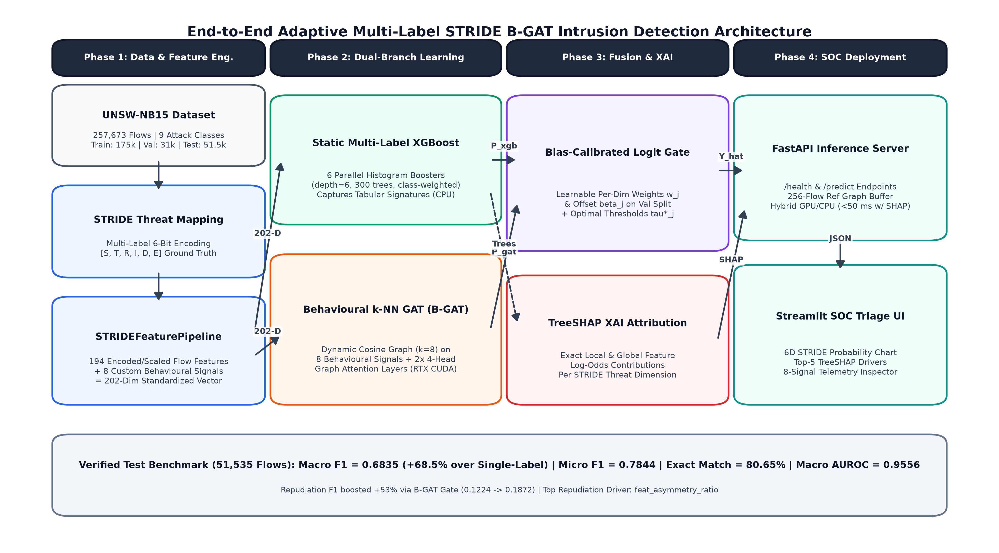
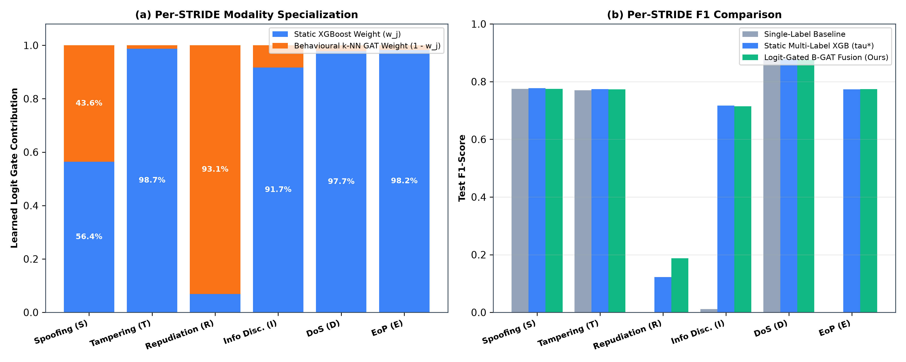

# Adaptive Multi-Label Network Intrusion Detection using STRIDE Threat Decomposition, Behavioural Graph Attention Networks (`B-GAT`), and Explainable AI

[](https://www.python.org/)
[](https://pytorch.org/)
[](https://xgboost.readthedocs.io/)
[](https://fastapi.tiangolo.com/)
[](https://streamlit.io/)
[](https://research.unsw.edu.au/projects/unsw-nb15-dataset)

> **Full Project Report (PDF):** [`docs/Project_Report.pdf`](docs/Project_Report.pdf)

Conventional machine learning Network Intrusion Detection Systems (NIDS) force multi-stage cyberattacks into a single mutually exclusive class label, masking co-occurring security violations and leaving Security Operations Center (SOC) analysts with opaque alerts. This repository implements an **Adaptive Multi-Label NIDS** grounded in Microsoft's six-dimensional **STRIDE** threat framework (**S**poofing, **T**ampering, **R**epudiation, **I**nformation Disclosure, **D**enial of Service, and **E**levation of Privilege), fusing static tabular gradient boosting with a dynamic **Behavioural *k*-Nearest Neighbor Graph Attention Network (`B-GAT`)** and exact **TreeSHAP** explanations.

<p align="center">
  
</p>

---

## Key Contributions

* **6-Dimensional Multi-Label STRIDE Decomposition:** Maps nominal UNSW-NB15 traffic (`257,673` flows across Normal traffic and 9 attack families) onto non-exclusive 6-bit threat vectors $\mathbf{y}_i = [y_S, y_T, y_R, y_I, y_D, y_E] \in \{0, 1\}^6$.
* **Domain-Guided Behavioural Feature Engineering (`202-D`):** Combines `194` one-hot encoded and standardized flow features with **8 engineered behavioural security signals** (`feat_resource_exhaustion`, `feat_conn_burst_rate`, `feat_asymmetry_ratio`, `feat_session_entropy`, `feat_privesc_score`, `feat_stealth_probe`, `feat_payload_anomaly`, and `feat_repudiation_risk`).
* **Dual-Branch Hybrid Architecture (`XGBoost` + `B-GAT`):** Pairs 6 parallel class-weighted XGBoost ensembles (capturing sharp tabular decision boundaries) with a 2-layer, 4-head **Behavioural *k*-NN GAT** ($k = 8$) constructed dynamically via cosine similarity over the 8 behavioural signals—eliminating reliance on fragile host IP addresses.
* **Bias-Calibrated Logit-Gated Fusion:** Combines branch log-odds via learnable per-dimension gate weights $w_j \in (0, 1)$, additive logit offsets $\beta_j \in \mathbb{R}$, and validation-calibrated thresholds $\tau^*_j = [0.40, 0.40, 0.10, 0.35, 0.50, 0.30]$.
* **Exact TreeSHAP XAI & Hybrid GPU/CPU Serving:** Operationalized via a FastAPI microservice (`~49 ms` single-flow latency including 6-dimension SHAP attribution) and an interactive Streamlit SOC Triage Dashboard.

---

## Verified Experimental Results (`UNSW-NB15` Test Split, $N = 51,535$)

| Model Configuration | Macro F1 | Micro F1 | Hamming Loss | Exact Match | Macro AUROC |
| :--- | :---: | :---: | :---: | :---: | :---: |
| Single-Label XGBoost (Baseline) | 0.4057 | 0.6365 | 0.0978 | 57.29% | N/A |
| Static Multi-Label XGBoost ($\tau = 0.50$) | 0.5945 | 0.6959 | 0.1360 | 71.29% | 0.9540 |
| Static Multi-Label XGBoost (Calibrated $\tau^*$) | 0.6735 | **0.7851** | 0.0759 | 80.42% | 0.9540 |
| Standalone Behavioural *k*-NN GAT ($\tau = 0.50$) | 0.6685 | 0.7667 | 0.0832 | 78.25% | 0.9522 |
| Standalone Behavioural *k*-NN GAT (Calibrated $\tau^*$) | 0.6700 | 0.7670 | 0.0823 | 78.86% | 0.9522 |
| Naive Late Averaging (XGB + B-GAT, $\tau = 0.50$) | 0.6275 | 0.7307 | 0.1094 | 72.57% | 0.9536 |
| Logit-Gated B-GAT Fusion (Un-calibrated $\tau = 0.50$) | 0.6513 | 0.7698 | **0.0710** | 78.05% | **0.9556** |
| **Logit-Gated B-GAT Fusion + Calibrated $\tau^*$ (Ours)** | **0.6835** | 0.7844 | 0.0756 | **80.65%** | **0.9556** |

### Modality Gate Specialization & Low-Support Threat Recovery

* **+68.5% Relative Macro F1 Gain** over single-label XGBoost (`0.4057` $\rightarrow$ `0.6835`) with **80.65% Exact 6-Bit Vector Match**.
* **+53.0% Repudiation (`R`) F1 Improvement** over static multi-label XGBoost (`0.1224` $\rightarrow$ `0.1872`), where the learned gate automatically assigns **93.12% weight** ($1 - w_{\text{XGB}} = 0.9312$) to `B-GAT` and **43.62% weight** on Spoofing (`S`), while relying on `XGBoost` (`91.7%–98.7%`) for high-signal tabular dimensions (`T`, `I`, `D`, `E`).

<p align="center">
  
</p>

---

## Repository Structure

```text
stride-bgat-ids/
├── api/
│   └── main.py                        # Hybrid GPU/CPU FastAPI inference service (/health, /predict)
├── app/
│   └── dashboard.py                   # Interactive Streamlit + Plotly SOC Triage Dashboard
├── data/
│   └── processed/
│       ├── demo_sample_flows.csv      # Stratified test flows for live dashboard triage
│       └── feature_pipeline.joblib    # Serialized 202-D preprocessing & behavioural scaler
├── docs/
│   ├── Project_Report.pdf             # Complete 34-page Project Report
│   └── figures/                       # All 12 architecture, UML, ablation, ROC, CM & SHAP figures
├── outputs/
│   ├── artifacts/
│   │   ├── bgat.pt                    # Trained PyTorch Behavioural k-NN GAT checkpoint
│   │   ├── xgb_multilabel_models.joblib # 6 class-weighted STRIDE XGBoost classifiers
│   │   └── fusion_params.json         # Learned gate weights w_j, offsets beta_j & thresholds tau*_j
│   └── tables/                        # Verified CSV & LaTeX benchmark tables
├── src/
│   ├── stride_map.py                  # UNSW-NB15 to 6-bit STRIDE taxonomy mapper
│   ├── features.py                    # 202-feature pipeline (194 flow + 8 behavioural signals)
│   ├── models/
│   │   ├── xgb_baseline.py            # Single-label & multi-label XGBoost trainers
│   │   └── bgat.py                    # Behavioural cosine k-NN Graph Attention Network
│   ├── fusion.py                      # Bias-Calibrated Logit-Gated Fusion & tau* optimizer
│   ├── evaluate.py                    # Ablation suite, McNemar tests, ROC, CM & SHAP plots
│   ├── explain.py                     # Exact TreeSHAP local & global attribution engine
│   └── build_final_report.py          # Automated DOCX report builder
└── requirements.txt
```

-------

### Quickstart & Live SOC Triage Demo
1. Environment Setup

```bash
git clone https://github.com/Chetan-314/stride-bgat-ids.git
cd stride-bgat-ids
python -m venv .venv
# Windows PowerShell:
.venv\Scripts\Activate.ps1
pip install -r requirements.txt
```

2. Launch the FastAPI Inference Backend & Streamlit Dashboard
Open two terminals in the project root with .venv activated:

```bash
# Terminal 1: Start hybrid GPU/CPU FastAPI server [http://127.0.0.1:8000]
uvicorn api.main:app --host 127.0.0.1 --port 8000

# Terminal 2: Start interactive SOC Triage Dashboard (http://localhost:8501)
streamlit run app/dashboard.py
```

3. Re-Run Evaluation
*(Requires downloading the raw UNSW_NB15_training-set.csv and UNSW_NB15_testing-set.csv files into data/raw/ to retrain from scratch.)*

```bash
python -m src.evaluate

```


